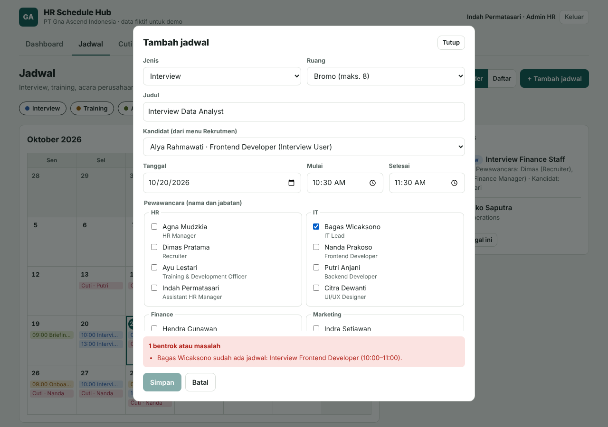
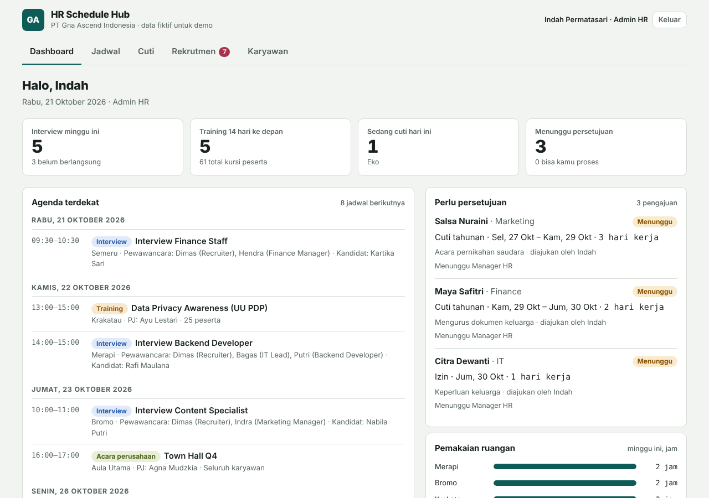
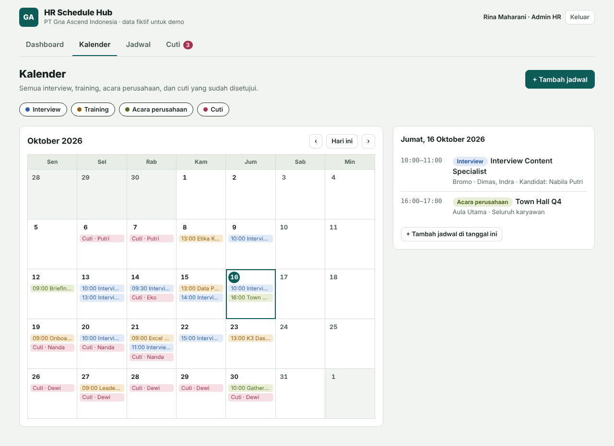
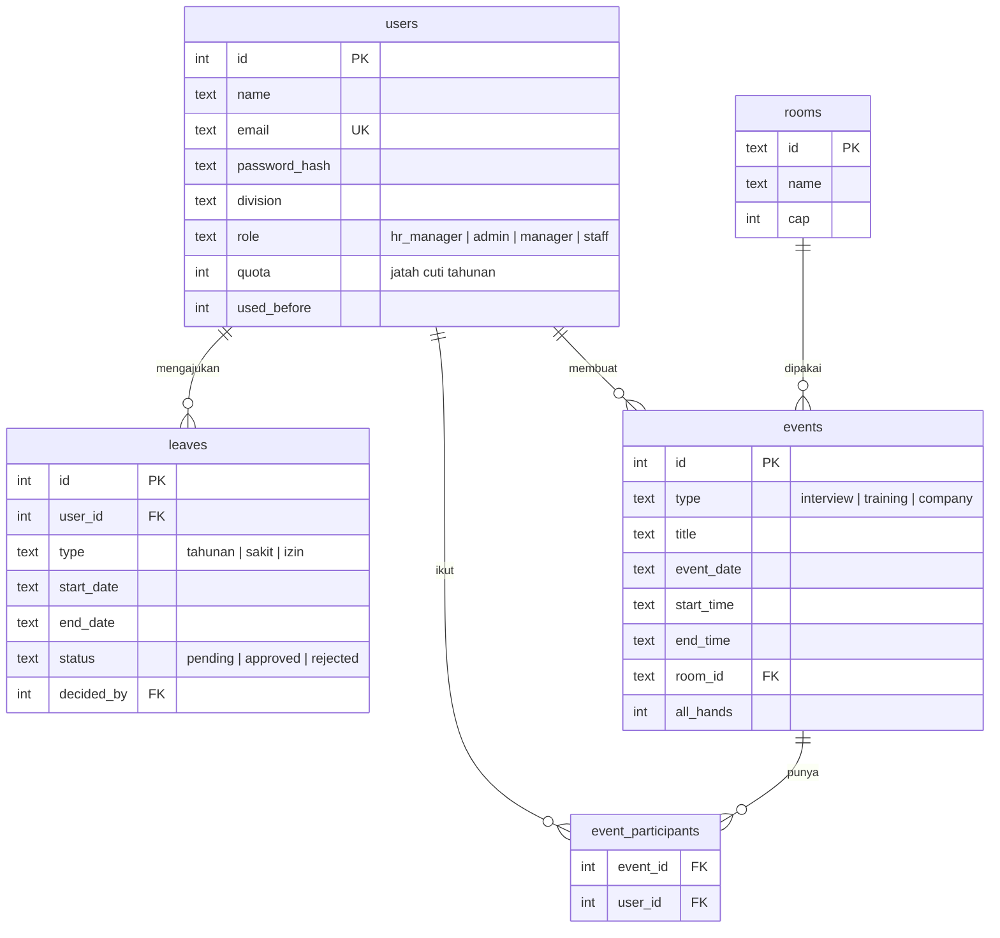

# HR Schedule Hub

Aplikasi web untuk mengatur jadwal tim HR: **interview rekrutmen, training, acara perusahaan, dan cuti karyawan** dalam satu kalender. Dibuat sebagai proyek portofolio dengan Node.js, memakai data fiktif **PT Gna Ascend Indonesia**.

Masalah yang diselesaikan: jadwal HR sering tabrakan. Satu interviewer dijadwalkan di dua interview pada jam yang sama, ruang rapat dipakai dua kegiatan, atau peserta training ternyata sedang cuti. Aplikasi ini menolak jadwal seperti itu sebelum tersimpan, dan menjelaskan alasannya.

**Live demo: https://hr-schedule-hub.vercel.app** (klik salah satu akun contoh di halaman login, kata sandi `password123`)

Catatan: demo berjalan di hosting gratis, jadi data bisa kembali ke data awal sewaktu-waktu. Itu normal.



## Fitur

- **Login dengan empat peran** dan pemisahan tugas: Admin HR membuat dan mengubah jadwal, Manager HR hanya menyetujui cuti, Manager divisi menyetujui cuti timnya, dan Karyawan mengajukan cuti sendiri.
- **Kalender bulanan** dengan filter jenis kegiatan, plus daftar jadwal yang bisa dicari dan disaring.
- **Deteksi bentrok** untuk interviewer/peserta, ruangan, kapasitas ruangan, dan peserta yang sedang cuti.
- **Cuti dengan alur persetujuan**: pengajuan, setuju/tolak oleh atasan, sisa kuota tahunan, dan aturan satu orang per divisi yang boleh cuti bersamaan.
- **Dashboard**: interview minggu ini, training mendatang, siapa yang cuti hari ini, pengajuan yang menunggu, dan pemakaian ruangan.
- Tampilan responsif (HP sampai desktop) dan mendukung mode gelap.

| Dashboard | Kalender |
|---|---|
|  |  |

## Tech stack

| Bagian | Pilihan |
|---|---|
| Server | Node.js 22.13+, Express 5 |
| Database | SQLite lewat modul bawaan Node.js `node:sqlite` (satu file, tanpa paket tambahan) |
| Autentikasi | JWT di cookie `httpOnly`, password di-hash dengan `bcryptjs` |
| Keamanan | `helmet` (CSP), `express-rate-limit`, validasi input manual |
| Frontend | HTML, CSS, dan JavaScript biasa (tanpa framework, tanpa build step) |
| Tes | `node:test` bawaan Node.js |

## Menjalankan di komputer sendiri

Butuh Node.js versi 22.13 atau lebih baru (modul `node:sqlite` baru bisa dipakai tanpa flag mulai versi itu). Cek dengan `node -v`.

```bash
npm install
npm start
```

Buka http://localhost:3000. Saat pertama kali dijalankan, database dibuat di `data/hr.db` dan diisi data fiktif otomatis.

Konfigurasi opsional lewat file `.env` (contoh ada di `.env.example`).

### Akun demo

Semua akun memakai kata sandi `password123`. Di halaman login ada daftar akun yang bisa diklik.

| Email | Peran |
|---|---|
| `agna@gnaascend.test` | Manager HR (hanya menyetujui cuti, tidak mengubah jadwal) |
| `indah@gnaascend.test` | Admin HR (Assistant HR Manager, mengelola jadwal) |
| `dimas@gnaascend.test` | Admin HR (Recruiter) |
| `bagas@gnaascend.test` | Manager IT |
| `indra@gnaascend.test` | Manager Marketing |
| `salsa@gnaascend.test` | Karyawan Marketing |
| `fajar@gnaascend.test` | Karyawan Finance |

Email lain mengikuti pola `namadepan@gnaascend.test`.

### Skenario yang bisa dicoba

1. Masuk sebagai **Indah**, buka Kalender, lalu tambah interview Selasa pukul 10:30 dengan Bagas. Ditolak karena Bagas sudah ada interview 10:00 sampai 11:00.
2. Masuk sebagai **Salsa** dan ajukan cuti tahunan 15 hari kerja. Ditolak karena sisa kuota tidak cukup.
3. Masuk sebagai **Indra** (atau **Agna**) dan setujui cuti Salsa. Setelah itu persetujuan cuti lain dari Marketing di tanggal yang sama akan ditolak.

### Perintah lain

```bash
npm test         # jalankan semua tes
npm run seed     # kosongkan database lalu isi ulang dengan data fiktif
npm run dev      # jalankan server dengan auto-reload
```

Tanggal pada data fiktif dihitung relatif terhadap minggu saat database diisi, supaya kalender selalu terisi. Jalankan `npm run seed` lagi bila datanya sudah terasa lama.

## Struktur proyek

```
src/
  server.js          titik masuk, mengisi data demo bila database kosong
  app.js             Express: middleware keamanan, routing, error handler
  db.js              koneksi SQLite dan fungsi baca/tulis
  schema.sql         definisi tabel
  logic.js           aturan bisnis (bentrok, kuota cuti, hak persetujuan)
  validate.js        validasi dan pembersihan input
  seed.js            data fiktif PT Gna Ascend Indonesia
  middleware/auth.js verifikasi cookie sesi dan pengecekan peran
  routes/            auth, events, leaves
public/              frontend (index.html, app.js, styles.css)
test/                tes unit dan tes API
docs/screenshots/    gambar untuk README
```

## Desain database



## API

Semua endpoint selain login butuh cookie sesi. Respons error berbentuk `{ "error": "pesan" }`.

| Method | Path | Akses | Fungsi |
|---|---|---|---|
| POST | `/api/auth/login` | publik | Login, mengatur cookie sesi |
| POST | `/api/auth/logout` | publik | Menghapus cookie sesi |
| GET | `/api/auth/me` | login | Data pengguna saat ini |
| GET | `/api/auth/demo` | publik | Daftar akun contoh (mati bila `DEMO_MODE=false`) |
| GET | `/api/bootstrap` | login | Pengguna, karyawan, ruangan, jadwal, dan cuti sekaligus |
| GET | `/api/events` | login | Daftar jadwal |
| POST | `/api/events` | Admin HR | Membuat jadwal |
| PUT | `/api/events/:id` | Admin HR | Mengubah jadwal |
| DELETE | `/api/events/:id` | Admin HR | Menghapus jadwal |
| GET | `/api/leaves` | login | Daftar pengajuan cuti |
| POST | `/api/leaves` | login | Mengajukan cuti untuk diri sendiri |
| POST | `/api/leaves/:id/approve` | Manager HR, atau Manager divisi yang sama | Menyetujui |
| POST | `/api/leaves/:id/reject` | Manager HR, atau Manager divisi yang sama | Menolak, dengan `note` opsional |

Kode status: `400` input tidak valid, `401` belum login, `403` tidak berwenang, `404` tidak ditemukan, `409` bentrok atau melanggar aturan (isi `conflicts` atau `errors` menjelaskan alasannya).

## Keputusan teknis

**Bentrok dicek di server, bukan hanya di browser.** Browser menampilkan pratinjau instan supaya pengguna langsung tahu masalahnya, tetapi yang menentukan adalah server. Permintaan yang dikirim langsung lewat `curl` pun tetap ditolak. Data yang dipakai browser bisa juga sudah basi, misalnya admin lain baru saja menambah jadwal, sehingga keputusan akhir harus ada di satu tempat yang memegang data terbaru.

**Satu file aturan untuk dua sisi.** `src/logic.js` berisi fungsi murni tanpa akses database atau jaringan. File yang sama dimuat Node.js di server dan dikirim ke browser, jadi pratinjau dan keputusan server tidak pernah berbeda. Karena murni, fungsi-fungsi ini mudah dites tanpa menyalakan server.

**Pengecekan dan penyimpanan tidak bisa disela.** `node:sqlite` bersifat sinkron, jadi urutan "baca data, periksa bentrok, simpan" di satu proses berjalan tanpa disela permintaan lain. Penyimpanan jadwal beserta pesertanya dibungkus transaksi (`BEGIN IMMEDIATE`) supaya tidak ada jadwal setengah jadi. Bila aplikasi dijalankan lebih dari satu proses, perlu kunci tulis atau database server seperti PostgreSQL.

**Sesi lewat cookie `httpOnly`.** JavaScript di halaman tidak bisa membaca token, sehingga celah XSS tidak otomatis membocorkan sesi. Cookie memakai `SameSite=Lax` dan menjadi `Secure` di produksi.

**Hal keamanan lain.** Password disimpan sebagai hash bcrypt. Login dibatasi 10 percobaan gagal per 15 menit per IP. Login memakai hash palsu bila email tidak ada, supaya waktu respons tidak membocorkan email mana yang terdaftar. Pengguna diambil ulang dari database di setiap permintaan, jadi perubahan peran langsung berlaku. Semua input divalidasi di `validate.js`, dan query memakai parameter terikat. Header CSP dari `helmet` memblokir script dari luar.

**Tanggal sebagai teks `YYYY-MM-DD`.** Dengan begitu perbandingan tanggal cukup memakai urutan teks dan tidak ada kejutan zona waktu. Hitungan "hari ini" di server memakai zona waktu perusahaan (`APP_TIMEZONE`), bukan zona waktu mesin server.

## Tes

`npm test` menjalankan 31 tes:

- **Unit** (`test/logic.test.js`): tabrakan orang, ruangan, kapasitas, jadwal berurutan yang tidak dianggap bentrok, hitungan hari kerja, kuota cuti, aturan satu divisi, dan siapa yang boleh menyetujui.
- **API** (`test/api.test.js`): server sungguhan dengan database di memori. Mencakup login, hak akses per peran, penolakan bentrok tanpa menyimpan apa pun, validasi input, dan seluruh alur persetujuan cuti.

## Deploy

Demo online berjalan di Vercel (lihat `vercel.json` dan `api/index.js`; database ada di memori sementara dan diisi ulang otomatis). Aplikasi juga bisa berjalan di platform Node.js lain (Render, Railway, Fly.io). Yang perlu diatur:

1. Isi `JWT_SECRET` dengan string acak panjang. Server menolak start di produksi tanpa ini.
2. Set `NODE_ENV=production` dan `TRUST_PROXY=true`.
3. SQLite menyimpan data di satu file. Pasang disk persisten dan arahkan `DB_PATH` ke sana. Tanpa disk persisten, data kembali ke awal setiap kali server restart. Itu cukup untuk demo portofolio karena data diisi ulang otomatis.
4. `DEMO_MODE=true` menampilkan akun contoh di halaman login. Cocok untuk demo dengan data fiktif, matikan bila dipakai sungguhan.

## Keterbatasan dan rencana pengembangan

- Token sesi tidak bisa dicabut dari server sebelum kedaluwarsa (8 jam). Logout hanya menghapus cookie di browser.
- Semua pengguna yang login bisa melihat semua jadwal, termasuk nama kandidat interview. Di aplikasi sungguhan, interview sebaiknya hanya terlihat oleh panitia.
- `node:sqlite` masih berstatus eksperimental di Node.js 22 dan 24. Skrip npm sudah menyembunyikan peringatannya, tetapi API-nya bisa berubah di versi mendatang.
- Belum ada ganti password, reset password, atau pengelolaan karyawan lewat antarmuka.
- Belum ada pengingat email H-1 dan jadwal berulang.
- Semua data dimuat sekaligus. Untuk data besar perlu filter tanggal dan paginasi di API.
- Pindah ke PostgreSQL bila perlu lebih dari satu proses server. Query saat ini tersebar di `src/db.js`, `src/routes/`, dan `src/middleware/auth.js`, jadi sebaiknya dirapikan dulu menjadi satu lapisan akses data.

## Cerita teknis untuk wawancara

Kalau ditanya "bagian tersulit apa?", jawabannya ada di deteksi bentrok:

1. Dua rentang waktu bentrok bila `mulaiA < selesaiB && mulaiB < selesaiA`. Dengan batas tegas seperti itu, interview 10:00 sampai 11:00 dan 11:00 sampai 12:00 tidak dianggap bentrok.
2. Satu jadwal bisa bentrok dengan beberapa hal sekaligus (orang, ruangan, cuti, kapasitas), jadi fungsi mengembalikan daftar masalah, bukan hanya benar atau salah.
3. Saat mengubah jadwal, jadwal itu sendiri harus dikecualikan dari pengecekan, kalau tidak setiap perubahan akan bentrok dengan versi lamanya.
4. Cuti butuh pemeriksaan dua kali: saat diajukan dan saat disetujui, karena cuti rekan satu divisi bisa disetujui di antara keduanya.
